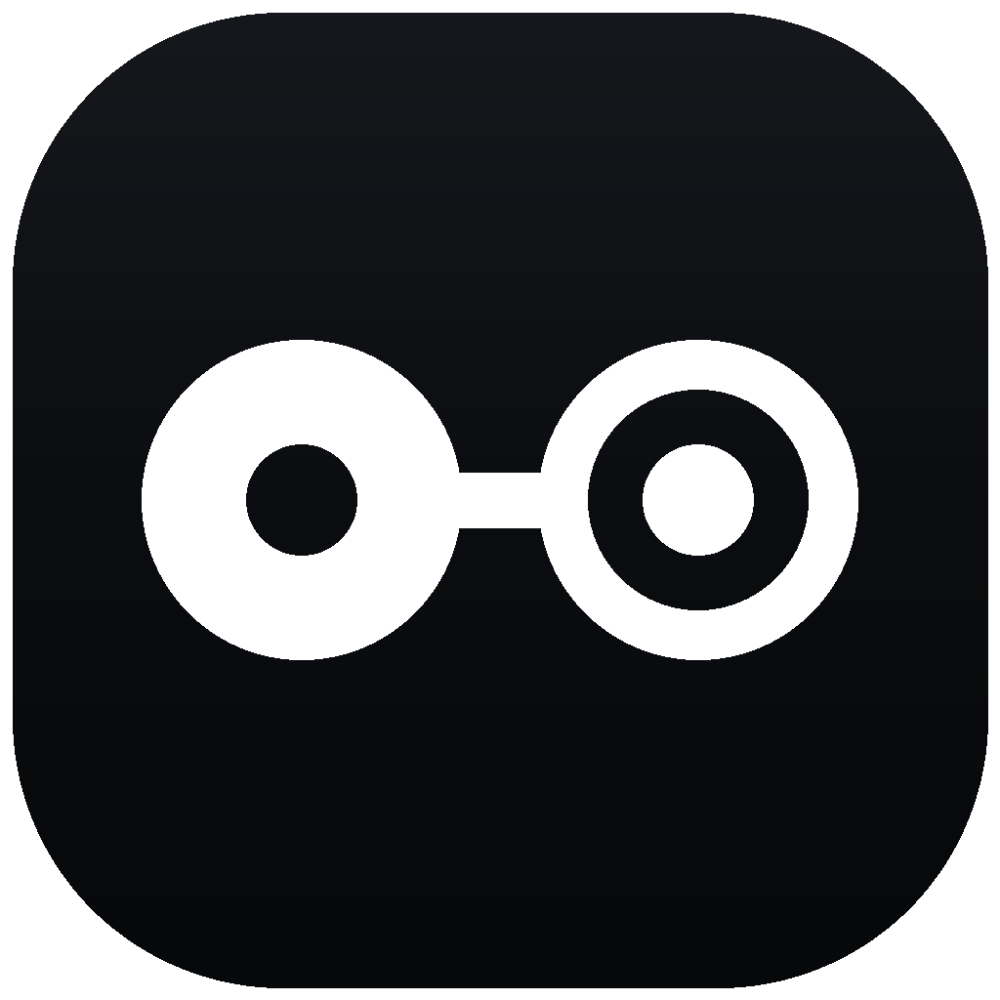
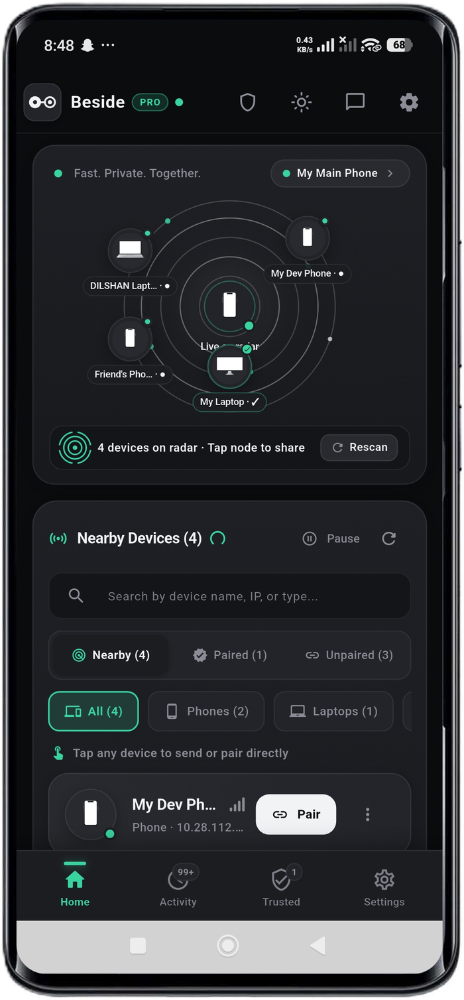

<p align="center">
  
</p>

<h1 align="center">Beside for Android</h1>

<p align="center">
  <strong>Fast Private Together</strong><br>
  <em>Send it. It's there. — Direct local-first peer-to-peer file, folder, and text sharing between Android and Windows over Wi-Fi.<br>Mutual TLS 1.3, zero cloud, zero accounts, flat 64 KB RAM bounded streaming.</em>
</p>

<p align="center">
  <a href="https://beside-license-worker.khthisald.workers.dev"></a>
  <a href="https://github.com/thisma-labs/beside-android-support/issues"></a>
  <a href="https://github.com/thisma-labs/beside-windows-support"></a>
  <a href="https://github.com/thisma-labs/beside-android-support/releases/latest"></a>
  
  
</p>

<p align="center">
  <picture>
    <source media="(prefers-color-scheme: dark)" srcset="assets/phone-hero-opt.png">
    <source media="(prefers-color-scheme: light)" srcset="assets/phone-hero-light-opt.png">
    
  </picture>
</p>

---

## Overview

**Beside for Android** is a dedicated, mobile-first sharing application designed for Android smartphones and tablets (Android 8.0 Oreo through Android 14). Engineered with a reactive Flutter mobile interface and a compiled native Rust core (`librust_bridge.so` built for `arm64-v8a`), Beside streams files, full directory trees, and text snippets directly across your local Wi-Fi network at wire speed with zero intermediate cloud relays.

### The 4-Tab Mobile Navigation

- **Home Tab**: Local device identity card (device name, IP address, mDNS status indicator), nearby device cards with one-tap pair/send actions, and quick action buttons (Files, Folders, Direct Message).
- **Activity Tab**: Chronological transfer history with folder nesting, file size badges, and message log.
- **Trusted Devices Tab**: Pinned cryptographic identities with instant trust revocation and pairing shortcuts.
- **Settings Tab**: Device identity configuration, Storage Access Framework (SAF) download directory picker, theme preferences, and Pro license status.

---

## Android Native Platform Integrations

Beside utilizes Android's most powerful native system services for seamless sharing:

| Native Service | Purpose & Implementation |
| :--- | :--- |
| **Android Share Sheet** | Intercepts standard system `ACTION_SEND` and `ACTION_SEND_MULTIPLE` intents. Share photos, videos, documents, or URLs directly from Google Photos, YouTube, or Files into Beside's outgoing queue. |
| **Gallery Auto-Scan** | When photo or video transfers complete, Beside invokes `MediaScannerConnection` to index files in Android's `MediaStore`, making them appear instantly in your camera roll and Google Photos without a device restart. |
| **Foreground Service** | `BesideTransferService` maintains an ongoing notification during active transfers, ensuring Android does not kill the process when you switch apps or turn off the screen. |
| **Wi-Fi & Wake Locks** | Automatically acquires `WifiManager.MulticastLock` for mDNS discovery, and high-performance Wi-Fi & CPU WakeLocks during streaming to maintain wire speeds on modern battery-saving OEM roms. |
| **Storage Access Framework (SAF)** | Full support for scoped storage and persisted document tree URIs on Android 10, 11, 12, 13, and 14, allowing you to save received files directly to custom folders or SD cards. |
| **Hardware Key Vault** | Device private identity keys are encrypted at rest inside the **Android Keystore (AES-256-GCM)** backed by hardware-isolated security modules (TEE / StrongBox). |

---

## Free vs. Pro Edition Matrix

| Feature | Beside Free ($0 Forever) | Beside Pro ($14.99 USD Lifetime &bull; 3 Devices) |
| :--- | :---: | :---: |
| **Pricing** | Free Forever ($0) | $14.99 One-Time Lifetime Purchase |
| **Personal Devices Covered** | 1 Device | Up to 3 Personal Devices |
| **Max Outgoing File Size** | 1 MB per transfer | **Unlimited** (Bounded 64 KB RAM streaming) |
| **Batch Transfers & Folders** | 1 File per transfer | **Unlimited** files & full directory trees |
| **Direct LAN Text Messaging** | Up to 40 characters | **Full-length** messages up to 1 MB |
| **Paired Peers in TrustStore** | 1 Paired Peer | **Unlimited** Pinned Peers |
| **Simultaneous Multi-Device Sharing** | 1 recipient at a time | **Simultaneous multi-device fanout** |
| **Device Groups** | 0 Groups | **Unlimited** custom device groups |
| **Zero-Click Auto-Accept** | Disabled | **Enabled** (Opt-in toggle for trusted peers) |
| **Receiving from Pro Senders** | **Unlimited & Free Forever** | **Unlimited & Free Forever** |
| **Android System Integrations** | **Full Access Included** | **Full Access Included** |

---

## Downloads & Verification (Android v0.3.0)

| Package | Format | Architecture | Size | Checksum (SHA-256) | Download |
| :--- | :---: | :---: | :---: | :---: | :---: |
| **Signed Release APK** | `.apk` | `arm64-v8a` | 27.78 MB | `c4caf733ec9f407ab45e79b3aa34d5ad524471b93ed4c1654fb6c49725dbeae8` | [**Download Beside-v0.3.0-Android-arm64.apk**](https://github.com/thisma-labs/beside-android-support/releases/download/android-v0.3.0/Beside-v0.3.0-Android-arm64.apk) |

### Verifying Checksums in Terminal

```bash
sha256sum Beside-v0.3.0-Android-arm64.apk
# Expected: c4caf733ec9f407ab45e79b3aa34d5ad524471b93ed4c1654fb6c49725dbeae8
```

### In-Place Upgrade & Cryptographic Signature Guarantee

All official Beside APK releases are signed with our consistent cryptographic release certificate:
```
Certificate SHA-256 Digest:
84:75:D9:3B:2F:C4:6C:14:24:7A:77:A4:66:BC:C8:6D:49:5D:9B:D3:95:68:47:58:E4:6D:AF:58:1B:AE:A2:9E
```
Installing this APK over an existing Beside installation performs a seamless in-place upgrade without data loss or re-pairing.

---

## Installation & Sideloading Guidance

When installing an APK directly outside the Play Store, Android shows a standard security notice: *"File might be harmful"* or requests *"Install unknown apps"* permission. This is standard Android security for all sideloaded applications. Simply tap **Settings**, toggle **Allow from this source**, and proceed with the installation.

### Optimizing Battery Settings for Large Transfers

On devices running aggressive battery managers (Xiaomi MIUI / HyperOS, Samsung One UI, Huawei EMUI):
1. Open **Android Settings &rarr; Apps &rarr; Beside**.
2. Tap **Battery** (or Battery Saver).
3. Select **Unrestricted** (or "No restrictions"). This allows Beside to receive large file batches in the background when your screen is locked.

---

## Official Storefronts & Links

- **Official Website**: [https://beside-license-worker.khthisald.workers.dev](https://beside-license-worker.khthisald.workers.dev)
- **Android Issues & Help**: [https://github.com/thisma-labs/beside-android-support/issues](https://github.com/thisma-labs/beside-android-support/issues)
- **Windows Support Portal**: [https://github.com/thisma-labs/beside-windows-support](https://github.com/thisma-labs/beside-windows-support)
- **Buy Beside Pro Lifetime**: [https://thismalabs.gumroad.com/l/beside-pro](https://thismalabs.gumroad.com/l/beside-pro)
- **itch.io Community**: [https://thisma-labs.itch.io/beside](https://thisma-labs.itch.io/beside)
- **SourceForge Mirror**: [https://sourceforge.net/projects/beside-android](https://sourceforge.net/projects/beside-android)
- **GitHub Issues**: [https://github.com/thisma-labs/beside-android-support/issues](https://github.com/thisma-labs/beside-android-support/issues)
